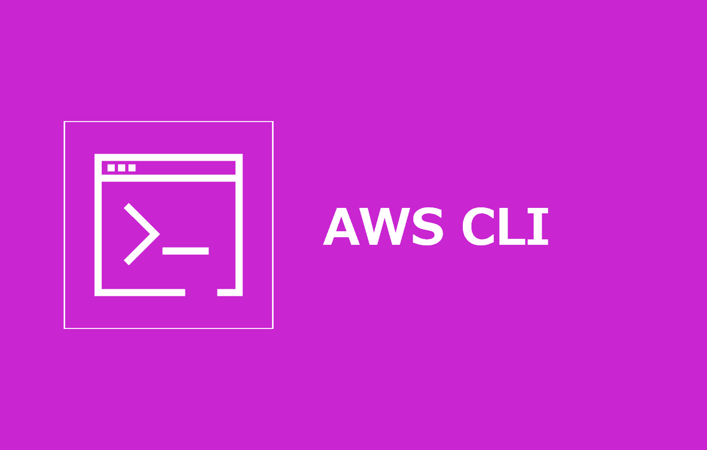

# AWS Command Line Interface インストール手順

> [!NOTE]
> - AWS の各サービスをコマンドラインから操作する公式 CLI
> - マネジメントコンソールを使わずに、AWS リソースの操作・確認やスクリプトによる自動化を行うために使用

> [!WARNING]
> - *AWS CLI* v1 と v2 は同じ `aws` コマンド名を使うため、以前 *pip* 等で v1 をインストールしていた場合は、アンインストールしてから v2 をインストールしてください (例: `pip uninstall awscli` )
> - 残っていると PATH の順番によって v1 が使われます。 `aws --version` が `aws-cli/2.x` になっていることを確認してください
> - v1 から v2 への変更点は [移行ガイド](https://docs.aws.amazon.com/ja_jp/cli/latest/userguide/cliv2-migration.html) を参照してください

## 目次

- [Windows](#windows)
- [Mac](#mac)
- [バージョンアップ](#バージョンアップ)
- [参考資料](#参考資料)

## Windows

### 1. パッケージサイレントインストール

Powershellにて以下コマンドを実行

```powershell
msiexec.exe /i https://awscli.amazonaws.com/AWSCLIV2.msi /qn # /i: インストール / /qn: 画面を表示せずにインストール
```

### 2. インストール確認

```powershell
aws --version
```

## Mac

### 1. *AWS CLI* インストール

```zsh
mise install aws
mise use --global aws@latest
```

> [!NOTE]
> - *mise* のセットアップは [こちら](../mise-en-place/README.md) を参照

> [!TIP]
> - `brew` でもインストール可能 ( `brew install awscli` )
> - その場合、手順 2 は不要です
> - *mise* と `brew` を併用すると `aws` が 2 つになり、 PATH の順番で使われる方が変わるため、どちらか一方にしてください

### 2. `symlink_bins` 設定

- `~/.config/mise/config.toml` の `[tools]` に追加された *aws* の行を以下に修正

```toml
aws = { version = "latest", symlink_bins = "true" }
```

> [!NOTE]
> - *mise* でインストールした *AWS CLI* はパッケージ内の深い階層に実行ファイルが配置されます
> - `symlink_bins` を有効にすると、実行ファイル ( `aws` / `aws_completer` ) へのシンボリックリンクが作成され PATH に追加されます
> - `aws --version` でバージョンが表示されればOKです

> [!WARNING]
> - `symlink_bins` を設定しない場合、実行ファイルが配置されたディレクトリ自体が PATH に追加されます
> - 同ディレクトリには *AWS CLI* 同梱の `Python` / `python3.14` や各種ライブラリも含まれるため、以下の問題が発生し得ます
>   - macOS は大文字小文字を区別しないため、 `python` コマンドが *AWS CLI* 同梱の `Python` に解決され、 *uv* や *pyenv* でインストールした *Python* より優先される
>   - *uv* 等でインストールした同名バージョンの `python3.x` と衝突する
>   - 不要なコマンドが補完候補に表示される

## バージョンアップ

### Windows

- *PowerShell* を管理者権限で起動し、以下のコマンドを実行

```powershell
aws update
```

> [!NOTE]
> - `aws update` は *AWS CLI* 2.36.0 以降で、インストールスクリプトや公式インストーラ (MSI) でインストールした場合に使えます
> - 全ユーザー向けにインストールしている場合は、管理者権限での実行が必要です
> - 2.36.0 より前のバージョンの場合は、 [Windows の手順 1](#1-パッケージサイレントインストール) の `msiexec` を再実行すると最新版に上書きされます

### Mac

```zsh
mise upgrade aws
```

> [!WARNING]
> - *mise* で管理しているため、 `aws update` ではなく `mise upgrade` で更新してください (詳細は [mise のツールのバージョンアップ](../mise-en-place/README.md#ツールのバージョンアップ) を参照)

## 参考資料

### リファレンス

- [AWS CLI の最新バージョンのインストールまたは更新](https://docs.aws.amazon.com/ja_jp/cli/latest/userguide/getting-started-install.html)
