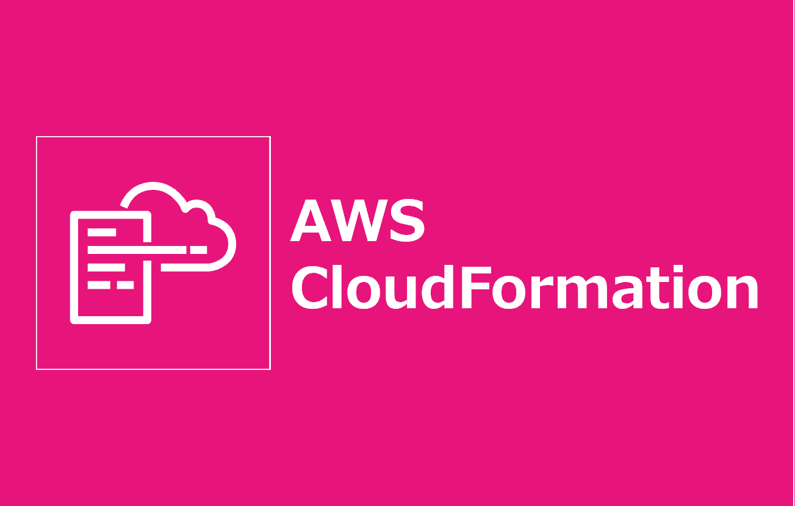

# CloudFormation Guard インストール手順

> [!NOTE]
> - AWS が開発している Policy as Code ツール
> - 「S3 バケットは暗号化必須」などのルールを独自の DSL で記述し、*CloudFormation* テンプレート (JSON / YAML) がルールに準拠しているかを検証するために使用
> - 構文・プロパティの検証は [CloudFormation Linter](../cfn-lint)、組織のポリシーへの準拠チェックは *cfn-guard* と使い分ける

## 目次

- [Windows (Git for Windows)](#windows-git-for-windows)
- [Mac](#mac)
- [Linux](#linux)
- [バージョンアップ](#バージョンアップ)
- [参考資料](#参考資料)

## Windows (Git for Windows)

### 1. *cfn-guard* リソースバイナリダウンロード

- [GitHub release page](https://github.com/aws-cloudformation/cloudformation-guard/releases) から最新の64bit版バイナリ( *cfn-guard-v3-x86_64-windows-latest.tar.gz* )をダウンロード

```bash
curl -o ~/Downloads/#1 -OL https://github.com/aws-cloudformation/cloudformation-guard/releases/latest/download/{cfn-guard-v3-x86_64-windows-latest.tar.gz}  # {} で囲んだファイル名を #1 に入れ、~/Downloads に同じファイル名で保存
```

### 2. バイナリデータを任意のフォルダに解凍

```bash
tar -xzf ~/Downloads/cfn-guard-v3-x86_64-windows-latest.tar.gz -C ~/
rm -f ~/Downloads/cfn-guard-v3-x86_64-windows-latest.tar.gz
```

### 3. ディレクトリにPATHを通す

```bash
echo 'export PATH=$PATH:$HOME/cfn-guard-v3-x86_64-windows-latest' >> ~/.bashrc
source ~/.bashrc
```

> [!NOTE]
> - `cfn-guard --version` でバージョンが表示されればOKです

## Mac

### 1. *cfn-guard* インストール

```zsh
brew install cloudformation-guard
```

> [!NOTE]
> - `cfn-guard --version` でバージョンが表示されればOKです

## Linux

### 1. *cfn-guard* リソースバイナリダウンロード

- [GitHub release page](https://github.com/aws-cloudformation/cloudformation-guard/releases) から最新の64bit版バイナリ( *cfn-guard-v3-x86_64-linux-latest.tar.gz* )をダウンロード

```bash
curl -OL https://github.com/aws-cloudformation/cloudformation-guard/releases/latest/download/cfn-guard-v3-x86_64-linux-latest.tar.gz
```

### 2. バイナリデータを任意のフォルダに解凍

```bash
tar -xzf cfn-guard-v3-x86_64-linux-latest.tar.gz
mkdir -p ~/bin; mv cfn-guard-v3-x86_64-linux-latest/cfn-guard ~/bin/; rm -rf cfn-guard-v3-x86_64-linux-latest*
```

### 3. ディレクトリにPATHを通す

```bash
echo 'export PATH="$HOME/bin:$PATH"' >> ~/.bashrc
source ~/.bashrc
```

> [!NOTE]
> - `cfn-guard --version` でバージョンが表示されればOKです

## バージョンアップ

| OS | 手順 |
| --- | --- |
| Windows (Git for Windows) | [Windows の手順 1・2](#1-cfn-guard-リソースバイナリダウンロード) を再実行 (最新版をダウンロードし、既存ファイルを上書き) |
| Mac | `brew upgrade cloudformation-guard` |
| Linux | [Linux の手順 1・2](#1-cfn-guard-リソースバイナリダウンロード-1) を再実行 (最新版をダウンロードし、既存ファイルを上書き) |

> [!NOTE]
> - Windows / Linux の手順はダウンロード URL が最新版 ( `releases/latest` ) を指しているため、そのまま再実行すれば最新版になります

## 参考資料

### リファレンス

- [GitHub - aws-cloudformation/cloudformation-guard](https://github.com/aws-cloudformation/cloudformation-guard)
- [AWS CloudFormation Guard とは - AWS CloudFormation Guard ユーザーガイド](https://docs.aws.amazon.com/ja_jp/cfn-guard/latest/ug/what-is-guard.html)
