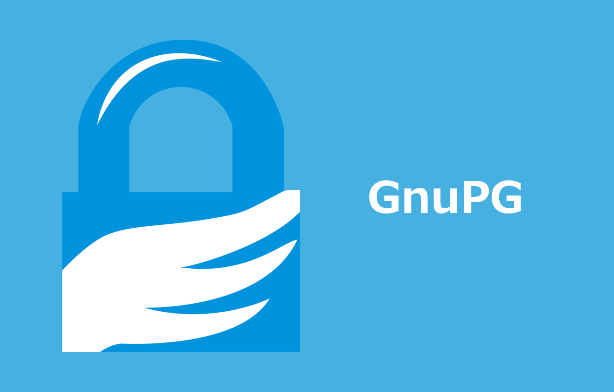

# GnuPG インストール手順

> [!NOTE]
> - OpenPGP 標準に準拠した暗号化・電子署名ツール
> - Git のコミットに署名し、作成者を証明するために使用

## 目次

- [Windows](#windows)
- [バージョンアップ](#バージョンアップ)
- [参考資料](#参考資料)

## Windows

> [!NOTE]
> - *Git for Windows* には *GnuPG* が同梱されているため、 *Git Bash* 上で利用するだけであれば本手順は不要です ( *Git for Windows* のインストールは [こちら](../git/README.md) )
> - *Git Bash* 以外 ( PowerShell や GUI の鍵管理ツール *Kleopatra* 等) でも利用したい場合は、以下の手順で *Gpg4win* をインストールしてください

### 1. *GnuPG* バイナリデータダウンロード

- [Gpg4win](https://www.gpg4win.org/) の配布サーバーから最新のWindows版インストーラ( *gpg4win-latest.exe* )をダウンロード

```bash
curl -o ~/Downloads/#1 -OL https://files.gpg4win.org/{gpg4win-latest.exe}  # {} で囲んだファイル名を #1 に入れ、~/Downloads に同じファイル名で保存
```

> [!TIP]
> - 配布サーバーから直接ダウンロードするため、公式サイト経由の場合に表示される寄付画面は表示されません

### 2. インストーラ実行

- *~/Downloads/gpg4win-latest.exe* をダブルクリックし、インストーラを実行

> [!NOTE]
> - デフォルト設定で問題ありません。

### 3. *Git* で使う *GnuPG* を *Gpg4win* に揃える

- *Gpg4win* をインストールすると、 *Git for Windows* 同梱の *GnuPG* と合わせて `gpg` が 2 つになり、鍵の保存先も別々になります

| *GnuPG* | 使われる場面 | 鍵の保存先 |
| --- | --- | --- |
| *Git for Windows* 同梱 | *Git Bash* の `gpg` / *Git* のコミット署名 (デフォルト) | `~/.gnupg` |
| *Gpg4win* | *PowerShell* / *Kleopatra* | `%APPDATA%\gnupg` |

- このままだと *Kleopatra* 等で作成した鍵が *Git* から見えず、コミット署名に失敗するため、 *Git* が使う `gpg` を *Gpg4win* のものに揃えます
- *PowerShell* で以下を実行し、 *Gpg4win* の `gpg.exe` のパスを確認

```powershell
where.exe gpg # 例: C:\Program Files\GnuPG\bin\gpg.exe (Gpg4win のバージョンにより C:\Program Files (x86)\GnuPG\bin\gpg.exe)
```

- 確認したパスを *Git* に設定

```bash
git config --global gpg.program "C:/Program Files/GnuPG/bin/gpg.exe" # 上で確認したパスに置き換え (区切りは / )
```

> [!NOTE]
> - `git config --global gpg.program` で設定内容を確認できます
> - *Git Bash* の `gpg` で作成済みの鍵がある場合は、 `gpg --export-secret-keys -a <鍵ID> > key.asc` で書き出し、 *Kleopatra* または *PowerShell* の `gpg --import key.asc` で取り込んでください (取り込み後は `key.asc` を削除)

## バージョンアップ

- [Windows の手順 1・2](#1-gnupg-バイナリデータダウンロード) を再実行し、最新版のインストーラで上書きインストールします

> [!NOTE]
> - ダウンロード URL ( `gpg4win-latest.exe` ) が常に最新版を指しているため、そのまま再実行すれば最新版になります
> - 鍵や設定 ( `%APPDATA%\gnupg` ) は上書きインストールでは削除されません

## 参考資料

### ブログ

- [【Windows】GnuPG(GPG)インストール方法:(2022年版)](https://www.ochappa.net/posts/gpg-win-setup)
- [macOS / Windows の Git 用に GnuPG (GPG) を準備する](https://qiita.com/watagashi/items/9425599678f6f93a0910)
