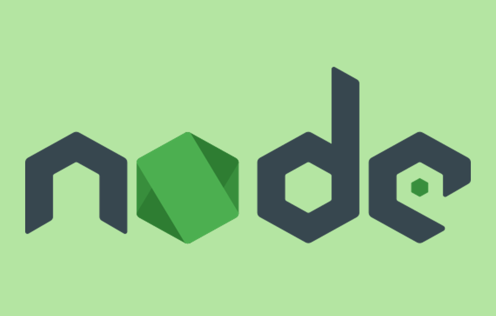

# Node Package Manager インストール手順

> [!NOTE]
> - *Node.js* のパッケージ(ライブラリ)を管理するツール
> - `npm` は `node` をインストールするとデフォルトでインストールされるため割愛
> - お好みのパッケージマネージャーを選択してください

## 目次

- [pnpm (Performant npm)](#pnpm-performant-npm)
  - [Windows (Git for Windows)](#windows-git-for-windows)
  - [Mac](#mac)
  - [Linux](#linux)
  - [npm / npx 抑止](#npm--npx-抑止)
  - [minimumReleaseAge 設定](#minimumreleaseage-設定)
  - [メジャーバージョンアップ時の注意](#メジャーバージョンアップ時の注意)
- [参考資料](#参考資料)

## pnpm (Performant npm)

> [!NOTE]
> - `minimumReleaseAge` で公開直後のパッケージを除外でき、サプライチェーン攻撃対策になるため *npm* / *npx* の代わりに使用

### Windows (Git for Windows)

#### 1. `pnpm` インストール

```bash
curl -fsSL https://get.pnpm.io/install.sh | sh -
```

> [!NOTE]
> - インストールスクリプトの中で `pnpm setup` が実行され、 `PNPM_HOME` ( `%LOCALAPPDATA%\pnpm` ) の作成と、Windows のユーザー環境変数 `PATH` への追加まで行われます
> - Windows の環境変数は起動中の *Git Bash* には反映されないため、次の手順で `~/.bashrc` にも PATH を追加します (再起動後は環境変数から引き継がれます)

#### 2. PATHを通す

```bash
echo 'export PATH="$HOME/AppData/Local/pnpm:$PATH"' >> ~/.bashrc
source ~/.bashrc
```

> [!NOTE]
> - `pnpm -v` でバージョンが表示されればOKです

### Mac

#### 1. `pnpm` インストール

```zsh
mise install pnpm
mise use --global pnpm@latest
```

> [!NOTE]
> - *mise* のセットアップは [こちら](../mise-en-place/README.md) を参照

> [!NOTE]
> - `pnpm -v` でバージョンが表示されればOKです

> [!TIP]
> - `brew` でもインストール可能

#### 2. `pnpm` でインストールするバイナリを保存するフォルダのセットアップ

```zsh
pnpm setup
```

> [!NOTE]
> - `pnpm install -g` でインストールしたコマンド (例: *AWS CDK* の `cdk` ) の保存先 `PNPM_HOME` ( `~/Library/pnpm` ) を作成し、 `~/.zshrc` に `PNPM_HOME` と PATH の設定を追記します
> - 実行しないと `pnpm install -g` が `ERR_PNPM_NO_GLOBAL_BIN_DIR` で失敗します
> - Windows / Linux はインストールスクリプトの中で自動実行されますが、 *mise* でインストールした場合は実行されないため手動で実行します
> - 追記された設定は `source ~/.zshrc` またはターミナルの再起動で反映されます

### Linux

#### 1. `pnpm` インストール

```bash
curl -fsSL https://get.pnpm.io/install.sh | sh -
```

#### 2. PATHを反映

```bash
source ~/.bashrc
```

> [!NOTE]
> - インストールスクリプトの中で `pnpm setup` が実行され、 `~/.bashrc` に `PNPM_HOME` ( `~/.local/share/pnpm` ) と PATH の設定が追記済みのため、読み込み直すだけで OK です
> - 追記内容は `grep -A5 '# pnpm' ~/.bashrc` で確認できます

> [!NOTE]
> - `pnpm -v` でバージョンが表示されればOKです

### `npm` / `npx` 抑止

- *pnpm* の `minimumReleaseAge` が効かない `npm` / `npx` を誤って実行しないよう、エイリアスで実行できなくします
- `npm` / `npx` を実行すると警告を表示し、 `&& false` で終了コードを失敗 (1) にして処理を止めます

#### Windows (Git for Windows) / Linux

```bash
echo '' >> ~/.bashrc
echo '## npm & npx stop' >> ~/.bashrc
echo "alias npm='echo \"WARNING: npm は実行しないでください\" && false'" >> ~/.bashrc
echo "alias npx='echo \"WARNING: npx は実行しないでください\" && false'" >> ~/.bashrc
source ~/.bashrc
```

#### Mac

```zsh
echo '' >> ~/.zshrc
echo '## npm & npx stop' >> ~/.zshrc
echo "alias npm='echo \"WARNING: npm は実行しないでください\" && false'" >> ~/.zshrc
echo "alias npx='echo \"WARNING: npx は実行しないでください\" && false'" >> ~/.zshrc
source ~/.zshrc
```

### `minimumReleaseAge` 設定

- 公開されてから何日経過したパッケージのみインストールを許容するかを設定する項目
- 値は分単位 (Ex. 1日 → 1440)
- `--location` パラメータには `global` (環境全体) or `project` (プロジェクト毎) で指定可能
- 全 OS 共通のコマンドです

```bash
pnpm config set --location=global minimumReleaseAge 10080 # 10080分 = 7日
```

> [!NOTE]
> - `pnpm config list --location=global` で結果を確認できる

### メジャーバージョンアップ時の注意

> [!NOTE]
> - グローバルパッケージ ( `pnpm add -g` / `pnpm install -g` でインストールしたもの) は `$PNPM_HOME/global/<レイアウトバージョン>/` に保存され、このディレクトリ名は *pnpm* のメジャーバージョンアップで変わることがあります
>   - *pnpm* 10 以前 : `$PNPM_HOME/global/5/`
>   - *pnpm* 11 / 12 : `$PNPM_HOME/global/v11/`
> - ディレクトリが変わると、旧バージョンでインストールしたパッケージは `pnpm ls -g` に表示されず管理外になります (*pnpm* の仕様であり、異常ではありません)
> - バージョンアップ後は、以下の手順でグローバルパッケージを再インストールしてください
>
> ```bash
> ls "$PNPM_HOME/global/5/node_modules" # 旧バージョンでインストールしていたパッケージを確認
> pnpm add -g typescript aws-cdk        # 新バージョンで再インストール (例)
> pnpm ls -g                            # 管理下に戻ったことを確認
> rm -rf "$PNPM_HOME/global/5"          # 確認後、旧バージョンのディレクトリを削除
> ```

## 参考資料

### リファレンス

- [インストール - pnpm](https://pnpm.io/ja/installation)
- [pnpm setup - pnpm](https://pnpm.io/ja/cli/setup)
- [@pnpm/global.commands (Isolated Global Packages) - GitHub](https://github.com/pnpm/pnpm/blob/main/pnpm11/global/commands/README.md)

### ブログ

- [【完全比較】npm vs pnpm vs Yarn vs Bun、最強のパッケージマネージャーはどれだ？ - Qiita](https://qiita.com/syukan3/items/0e3560bf0e2ae715f5d1)
- [【Node.js】npmからpnpmに乗り換える - Suzunatsu Web](https://www.suzunatsu.com/post/npm-to-pnpm-migration/)
- [pnpm とセキュアな依存管理 - blog.re-taro.dev](https://blog.re-taro.dev/p/01JJPCQXJEF4YTQTCZZPXBF69E)
- [npmとnpxでの最新パッケージ汚染予防策についてPATH操作とpnpmを併用してやってみた - DevelopersIO](https://dev.classmethod.jp/articles/20251128-preventing-package-contamination-using-path-manipulation-and-pnpm/)
- [npm から pnpm に移行する取り組み - Zenn](https://zenn.dev/korosuke613/scraps/936cce981d0209)
- [AWS CodeBuildを使ってビルドしているサイトのNodeパッケージマネージャーをnpmからpnpmに切り替えてみた - DevelopersIO](https://dev.classmethod.jp/articles/how-to-change-npm-to-pnpm-with-codebuild-configurations/)
- [pnpmのminimumReleaseAgeをグローバルとプロジェクトそれぞれに設定する方法 - Zenn](https://zenn.dev/takumin0423/articles/77b9b3b55bf1f9)
