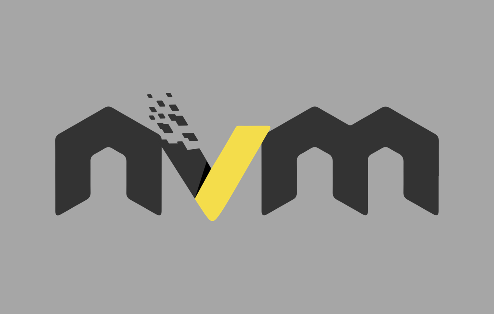

# Node Version Manager インストール手順

> [!NOTE]
> - *Node.js* の複数バージョンをインストール・切り替えるツール (Windows は *nvm-windows* )
> - プロジェクトごとに必要な *Node.js* のバージョンを使い分けるために使用

> [!NOTE]
> - パッケージのインストールには *npm* ではなく [pnpm](../node_package_manager/README.md) を使用してください
>   - `minimumReleaseAge` で公開直後のパッケージを除外でき、サプライチェーン攻撃対策になるため
>   - *pnpm* のグローバルパッケージは *Node.js* のバージョンとは別の場所に保存されるため、 *Node.js* のバージョンアップ後もそのまま使えます ( *npm* でインストールしたものは *Node.js* のバージョンごとに保存され、引き継がれません)

## 目次

- [Windows](#windows)
- [Mac](#mac)
- [Linux](#linux)
- [nvm 自体のバージョンアップ](#nvm-自体のバージョンアップ)
- [Node.js 切り替え後に古いバージョンの PATH が残る場合 (Mac / Linux)](#nodejs-切り替え後に古いバージョンの-path-が残る場合-mac--linux)
- [参考資料](#参考資料)

## Windows

### 1. `nvm-windows` ( Windows版 `Node.js` バージョンマネージャー)インストール

> [!WARNING]
> - 公式インストーラ等で *Node.js* を既にインストールしている場合は、 *nvm-windows* のインストール前にアンインストールし、 `C:\Program Files\nodejs` が残っていれば削除してください
> - システムの PATH にある *Node.js* は *nvm-windows* より優先されるため、残っていると `nvm use` で切り替えても古い *Node.js* が使われ続けます
> - v2 のインストーラは既存の *Node.js* を検出すると扱いを選ばせます ( `Copy` / `Adopt` / `Keep` / `Drop` ) 。 `Keep` を選ぶと既存の *Node.js* が残って優先されるため、既定の `Copy` (nvm 側へコピーして既存をアンインストール) を選んでください

- [GitHub](https://github.com/coreybutler/nvm-windows) から *nvm-<バージョン>-x64-setup.exe* をダウンロード
- デフォルト設定でインストール

### 2. `node.js` (LTS版) インストール

```bash
nvm install lts
```

### 3. LTS版の使用

```bash
nvm use lts
```

> [!NOTE]
> - `nvm list` でインストール済みのバージョンを確認できます
> - `nvm` でインストールした *Node.js* は、バージョンごとに以下のフォルダに格納されます
>   - *nvm-windows* v2 : 「 `~/AppData/Local/Author Software/nvm/installs/v{バージョン番号}/` 」 ( `nvm config` の `root` で変更可能)
>   - *nvm-windows* v1 : 「 `~/AppData/Roaming/nvm/v{バージョン番号}/` 」
> - *npm* でグローバルインストールしたパッケージも、そのバージョンのフォルダ内の `node_modules/` に格納されるため、別のバージョンには引き継がれません

## Mac

### 1. `nvm` インストール

```zsh
brew install nvm
```

### 2. `profile` 追加

```zsh
mkdir -p ~/.nvm
echo '' >> ~/.zshrc
echo '## nvm' >> ~/.zshrc
echo 'export NVM_DIR="$HOME/.nvm"' >> ~/.zshrc
echo '[ -s "/opt/homebrew/opt/nvm/nvm.sh" ] && \. "/opt/homebrew/opt/nvm/nvm.sh"' >> ~/.zshrc                                       # nvm.sh があれば読み込む (\. は source と同じ)
echo '[ -s "/opt/homebrew/opt/nvm/etc/bash_completion.d/nvm" ] && \. "/opt/homebrew/opt/nvm/etc/bash_completion.d/nvm"' >> ~/.zshrc # 補完スクリプトがあれば読み込む
```

### 3. `profile` 読み込み

```zsh
source ~/.zshrc
```

> [!NOTE]
> `nvm -v` でバージョンが表示されればOKです

### 4. `node.js` (LTS版) インストール

```zsh
nvm install --lts
nvm use --lts
```

> [!NOTE]
> - `node -v` でバージョンが表示されればOKです

## Linux

### 1. `nvm` インストール

```bash
NVM_V=v0.41.0
curl -o- https://raw.githubusercontent.com/nvm-sh/nvm/${NVM_V}/install.sh | bash
```

> [!NOTE]
> - `NVM_V` は実行時の最新バージョンに合わせてください ( [Releases](https://github.com/nvm-sh/nvm/releases) で確認できます)

### 2. `profile` 追加

```bash
echo '' >> ~/.bashrc
echo '##nvm' >> ~/.bashrc
echo 'export NVM_DIR="$HOME/.nvm"' >> ~/.bashrc
echo '[ -s "$NVM_DIR/nvm.sh" ] && \. "$NVM_DIR/nvm.sh"' >> ~/.bashrc                   # nvm.sh があれば読み込む (\. は source と同じ)
echo '[ -s "$NVM_DIR/bash_completion" ] && \. "$NVM_DIR/bash_completion"' >> ~/.bashrc # 補完スクリプトがあれば読み込む
```

### 3. `profile` 読み込み

```bash
source ~/.bashrc
```

> [!NOTE]
> `nvm -v` でバージョンが表示されればOKです

### 4. `node.js` (LTS版) インストール

```bash
nvm install --lts
nvm use --lts
```

> [!NOTE]
> - `node -v` でバージョンが表示されればOKです

## nvm 自体のバージョンアップ

| OS | 手順 |
| --- | --- |
| Windows ( *nvm-windows* v2 ) | `nvm upgrade` ( `nvm upgrade --check` で更新有無のみ確認) |
| Windows ( *nvm-windows* v1 ) | [GitHub](https://github.com/coreybutler/nvm-windows) から v2 のインストーラを実行 (v1.1.7 以降は設定とインストール済みの *Node.js* が v2 に移行されます) |
| Mac | `brew upgrade nvm` |
| Linux | `NVM_V` を最新版にして [Linux の手順 1](#1-nvm-インストール-1) を再実行 |

> [!NOTE]
> - Linux の *nvm* はインストールスクリプトが更新も兼ねており、再実行すると `~/.nvm` が新しいバージョンに更新されます

## Node.js 切り替え後に古いバージョンの PATH が残る場合 (Mac / Linux)

新しいバージョンの *Node.js* をインストールして切り替えた後も、 `echo $PATH` に古いバージョンの `~/.nvm/versions/node/v{バージョン番号}/bin` が残ることがあります。

```zsh
echo $PATH | tr ':' '\n' | grep nvm
```

```text
/Users/<ユーザー名>/.nvm/versions/node/v26.13.1/bin   # .zshrc の読み込み時に nvm が追加した新しいバージョン
/Users/<ユーザー名>/.nvm/versions/node/v24.13.1/bin   # 親プロセスから引き継いだ古いバージョン
```

> [!NOTE]
> - 設定ファイル ( `~/.zshrc` 等) の問題ではなく、古いバージョンを使っていたときに起動したターミナルアプリやエディタ ( VS Code 、 Claude Code 等) の環境変数を、新しく開いたシェルが引き継いでいるためです
> - 新しいバージョンが前に並ぶため `node` は新しいバージョンが使われ、実害はありません ( `which -a node` で確認できます)
> - 同じ理由で、 `/opt/homebrew/bin` 等の PATH が重複して並ぶこともあります

### 解消方法

ターミナルアプリやエディタを**完全に終了してから起動し直してください**。新しいタブやウィンドウを開くだけでは、アプリが持っている古い PATH を再び引き継ぐことがあります。

今開いているシェルだけを直す場合は、以下を実行します ( `v24.13.1` は残っている古いバージョンに置き換えてください) 。

```zsh
# zsh (Mac)
path=(${path:#$HOME/.nvm/versions/node/v24.13.1/bin}) # 古いバージョンの PATH を削除
typeset -U path                                       # 重複した PATH を削除
```

```bash
# bash (Linux)
export PATH=$(echo "$PATH" | tr ':' '\n' | grep -vx "$HOME/.nvm/versions/node/v24.13.1/bin" | awk '!seen[$0]++' | paste -sd: -) # 古いバージョンと重複した PATH を削除
```

> [!NOTE]
> - Windows ( *nvm-windows* ) はシンボリックリンクの差し替えでバージョンを切り替え、 PATH は変わらないため、この現象は起きません

## 参考資料

### リファレンス

- [nvm-sh / nvm - GitHub](https://github.com/nvm-sh/nvm)
- [coreybutler / nvm-windows - GitHub](https://github.com/coreybutler/nvm-windows)
- [Core configuration - NVM for Windows](https://docs.nvm-windows.com/cfg/core)
- [nvm use - NVM for Windows](https://docs.nvm-windows.com/command/nvm/use)
- [Global module shims - NVM for Windows](https://docs.nvm-windows.com/command/global-module-shims)

### ブログ

- [nvm-windowsでnode.jsのバージョン管理をする【Windows】](https://qiita.com/nezumori/items/504b26d26f3e6e3009e3)
- [[Node.js] nvmインストール手順(MacOS) - Zenn](https://zenn.dev/nok_c7/articles/536ac2d35bf9e6)
