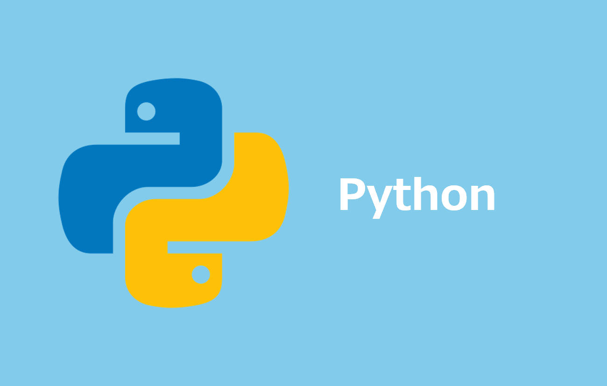

# Python Install Manager インストール手順

> [!NOTE]
> - python.org が提供する Windows 向けの公式 *Python* インストーラー兼バージョン管理ツール ( `py` コマンド)
> - Windows で、公式の方法により *Python* の複数バージョンを管理するために使用

> [!WARNING]
> - *Python* をインストールする手段 ( [pyenv](../pyenv_python3/README.md) / [PIM](../pim/README.md) / [uv](../uv_python3/README.md) ) はどれか 1 つに統一してください
> - いずれも `python` / `python3` コマンドを作成するため、併用すると PATH の順番によって使われる *Python* が変わり、パッケージのインストール先も意図しない *Python* になることがあります
> - 現在使われている *Python* は `which -a python3` (Windows の *PowerShell* では `Get-Command python -All` ) で確認できます

## 目次

- [Windows](#windows)
- [バージョンアップ時の注意](#バージョンアップ時の注意)
- [PIM と Python のバージョンアップ](#pim-と-python-のバージョンアップ)
- [参考資料](#参考資料)

## Windows

### 1. *pim* インストール

- [公式](https://www.python.org/downloads/windows/) より最新のインストーラー (`MSI package`) をダウンロード
- `msi` ファイルを実行してインストール

> [!NOTE]
> - ターミナルで `py list` が実行できればOKです

### 2. *python3* インストール - 最新版 -

```powershell
py install 3
```

> [!NOTE]
> - `python3 --version` でバージョンが表示されればOKです

### 3. *pip3* への `PATH` を通す

- 下記コマンドを実行し、グローバルショートカット用ディレクトリを取得

```powershell
py install --refresh
```

> [!NOTE]
> - インストール済みの Python のグローバルショートカット ( `python3` / `pip3` 等) を作り直すコマンドで、実行時にショートカットの格納先ディレクトリが表示されます

- 下記コマンドを `Powershell` で実行し、システムプロパティを起動
- 環境変数のシステム変数に上記コマンドで出力されたディレクトリを追加

```powershell
SystemPropertiesAdvanced
```

> [!NOTE]
> - ターミナルを再起動し、`pip3 --version` でバージョンが表示されればOKです

## バージョンアップ時の注意

> [!NOTE]
> - *Python* はマイナーバージョン ( `3.14` / `3.15` など) ごとに別の場所へインストールされ、 `pip install` でインストールしたパッケージもバージョンごとに保存されるため、新しいバージョンには引き継がれません
> - 旧バージョンでパッケージ一覧を書き出し、新バージョンで再インストールしてください
>
> ```powershell
> py -V:3.14 -m pip freeze > requirements.txt     # 旧バージョンのパッケージ一覧を書き出し
> py install 3.15                                 # 新バージョンをインストール
> py -V:3.15 -m pip install -r requirements.txt   # 新バージョンで再インストール
> py uninstall 3.14                               # 不要であれば旧バージョンを削除
> ```
>
> - バージョン番号は例です。 `py list` でインストール済みのバージョンを確認できます

## PIM と Python のバージョンアップ

### *PIM* ( `py` コマンド)

- [公式](https://www.python.org/downloads/windows/) から最新のインストーラーをダウンロードし、 [手順 1](#1-pim-インストール) と同様に実行します

> [!NOTE]
> - *Microsoft Store* 版の *PIM* は自動で更新されます

### *Python* (パッチバージョン)

```powershell
py install --update # インストール済みの Python を、同じマイナーバージョンの新しいリリースに更新
```

> [!NOTE]
> - 3.14 → 3.15 のようなマイナーバージョンの変更は、 [バージョンアップ時の注意](#バージョンアップ時の注意) を参照してください
> - 更新時、グローバルにインストールしたパッケージは削除されますが、 `site-packages` と `Scripts` は残ります

## 参考資料

### リファレンス

- [python.org](https://www.python.org/)
- [Windows で Python を使う - Python ドキュメント](https://docs.python.org/ja/3/using/windows.html)
- [pip freeze - pip documentation](https://pip.pypa.io/en/stable/cli/pip_freeze/)
- [アプリ インストーラーのセキュリティ機能](https://learn.microsoft.com/ja-jp/windows/msix/app-installer/app-installer-security-features)
