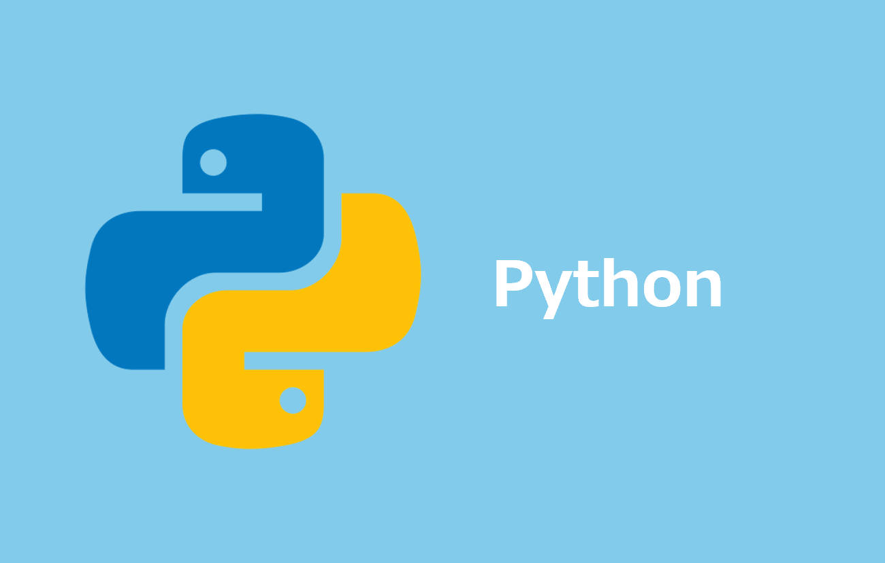

# pyenv インストール手順

> [!NOTE]
> - *Python* の複数バージョンをインストール・切り替えるバージョン管理ツール (Windows は *pyenv-win* )
> - プロジェクトごとに *Python* のバージョンを使い分けるために使用
> - パッケージ管理まで含めて統一する場合は [uv / Python3](../uv_python3/README.md) を参照

> [!WARNING]
> - *Python* をインストールする手段 ( [pyenv](../pyenv_python3/README.md) / [PIM](../pim/README.md) / [uv](../uv_python3/README.md) ) はどれか 1 つに統一してください
> - いずれも `python` / `python3` コマンドを作成するため、併用すると PATH の順番によって使われる *Python* が変わり、パッケージのインストール先も意図しない *Python* になることがあります
> - 現在使われている *Python* は `which -a python3` (Windows の *PowerShell* では `Get-Command python -All` ) で確認できます

## 目次

- [Windows (Git for Windows)](#windows-git-for-windows)
- [Linux](#linux)
- [バージョンアップ時の注意](#バージョンアップ時の注意)
- [Pythonエラー解消](#pythonエラー解消)
- [pyenv 自体のバージョンアップ](#pyenv-自体のバージョンアップ)
- [参考資料](#参考資料)

## Windows (Git for Windows)

### 1. *pyenv* (Pythonバージョン管理ツール)インストール

- Windowsは *pyenv-win* をインストールする
- [GitHub](https://github.com/pyenv-win/pyenv-win/blob/master/README.md#installation) からcloneする

```bash
git clone https://github.com/pyenv-win/pyenv-win.git "$HOME/.pyenv"
```

> [!WARNING]
> - Windows には、 `python` / `python3` と入力すると *Microsoft Store* を開くだけのコマンド (アプリ実行エイリアス) が標準で用意されています
> - これが優先されると *Python* が起動せず *Store* が開くため、「スタート」→「アプリ実行エイリアスの管理」で、 **アプリ インストーラー** の `python.exe` / `python3.exe` をオフにしてください

### 2. ディレクトリにPATHを通す

```bash
echo 'export PATH="$HOME/.pyenv/pyenv-win/shims:$PATH"' >> ~/.bashrc
echo 'export PATH="$HOME/.pyenv/pyenv-win/bin:$PATH"' >> ~/.bashrc
source ~/.bashrc
```

> [!NOTE]
> - `pyenv --version` で *pyenv* のバージョン確認が可能
> - バージョン確認時にWindows環境変数への登録を促す文言が表示され気になる方はPowershell で登録してください

### 3. *python3.14* インストール

```bash
pyenv install 3.14.10
```

> [!NOTE]
> - `pyenv install --list` でインストール可能バージョン一覧を取得できます
> - `pyenv versions` でインストール済み *python* バージョン確認が可能

### 4. *Global* 設定

```bash
pyenv global 3.14.10
```

> [!NOTE]
> - `python -V` でバージョンが表示されればOKです

## Linux

### 1. *Amazon Linux 2023* のみ実施

```bash
sudo dnf update -y
sudo dnf groupinstall -y "Development Tools"
sudo dnf install -y bzip2-devel ncurses-devel libffi-devel readline-devel openssl-devel zlib-devel
```

### 2. *pyenv* (Pythonバージョン管理ツール)インストール

```bash
curl -fsSL https://pyenv.run | bash
```

### 3. ディレクトリにPATHを通す

```bash
echo 'export PYENV_ROOT="$HOME/.pyenv"' >> ~/.bashrc
echo '[[ -d $PYENV_ROOT/bin ]] && export PATH="$PYENV_ROOT/bin:$PATH"' >> ~/.bashrc # pyenv 本体のディレクトリがあれば PATH に追加
echo 'eval "$(pyenv init - bash)"' >> ~/.bashrc                                     # shims (python コマンドを切り替える仕組み) を有効化
source ~/.bashrc
```

### 4. *python3.14* インストール

```bash
pyenv install 3.14.10
```

> [!NOTE]
> - `pyenv install --list` でインストール可能バージョン一覧を取得できます
> - `pyenv versions` でインストール済み *python* バージョン確認が可能

### 5. *Global* 設定

```bash
pyenv global 3.14.10
```

> [!NOTE]
> - `python -V` でバージョンが表示されればOKです

## バージョンアップ時の注意

> [!NOTE]
> - `pip install` でインストールしたパッケージは *Python* のバージョンごとに保存されるため、新しいバージョンに切り替えると旧バージョンのパッケージは引き継がれません
> - 切り替える前に旧バージョンでパッケージ一覧を書き出し、切り替え後に再インストールしてください
>
> ```bash
> pip freeze > ~/requirements.txt  # 切り替え前 (旧バージョン) で実行
> pyenv install <新バージョン>
> pyenv global <新バージョン>
> pip install -r ~/requirements.txt # 新バージョンで再インストール
> pyenv uninstall <旧バージョン>    # 不要であれば旧バージョンを削除
> ```

## Pythonエラー解消

### Windows UTF-8問題

#### Python3の文字エンコーディング設定を *UTF-8* に変更

> [!NOTE]
> - Git Bash (Git for Windows) を前提としたコマンドです

```bash
echo 'export PYTHONUTF8=1' >> ~/.bashrc
source ~/.bashrc
```

> [!NOTE]
> - Windows 上の *Python3* は、ファイル読み書き時の既定の文字コードに *cp932(Shift_JIS)* を使用します
> - そのため、 *Python* 製のツールやスクリプト全般で以下のような問題が発生し得ます
>   - 日本語を含む UTF-8 のファイル (YAML / JSON / Markdown 等) 読み込み時の `UnicodeDecodeError: 'cp932' codec can't decode ...`
>   - パイプやリダイレクト ( `> out.txt` / `| jq` 等) で出力した際の文字化け
>   - `pip install` 時のパッケージビルドエラー
> - 例えば *AWS CLI* では、 `aws cloudformation package` 実行時の yaml ファイル出力でエラーが発生します
> - 環境変数 `PYTHONUTF8=1` で *UTF-8 モード* を有効化し、 *Python3* の既定の文字コードを *UTF-8* にします
> - *Python3.15* 以降は *UTF-8 モード* が既定で有効になる予定です ( *PEP 686* )

## pyenv 自体のバージョンアップ

| OS | 手順 |
| --- | --- |
| Windows (Git for Windows) | `git -C ~/.pyenv pull` |
| Linux | `pyenv update` |

> [!NOTE]
> - Windows は *pyenv-win* を `git clone` でインストールしているため、 `git pull` で更新します ( *pyenv-win* の `pyenv update` はインストール可能な *Python* の一覧を更新するコマンドです)
> - Linux の `pyenv update` は、インストールスクリプト ( `pyenv.run` ) で一緒に導入される *pyenv-update* プラグインのコマンドです
> - インストール可能な新しい *Python* が `pyenv install --list` に表示されない場合も、上記で更新してください

## 参考資料

### リファレンス

- [pyenv - GitHub](https://github.com/pyenv/pyenv)
- [pyenv-win - GitHub](https://github.com/pyenv-win/pyenv-win)
- [pip freeze - pip documentation](https://pip.pypa.io/en/stable/cli/pip_freeze/)
- [PEP 686 – Make UTF-8 mode default](https://peps.python.org/pep-0686/)

### ブログ

- [PythonでUTF-8エンコーディングを正しく扱う方法](https://www.python.digibeatrix.com/archives/990)
