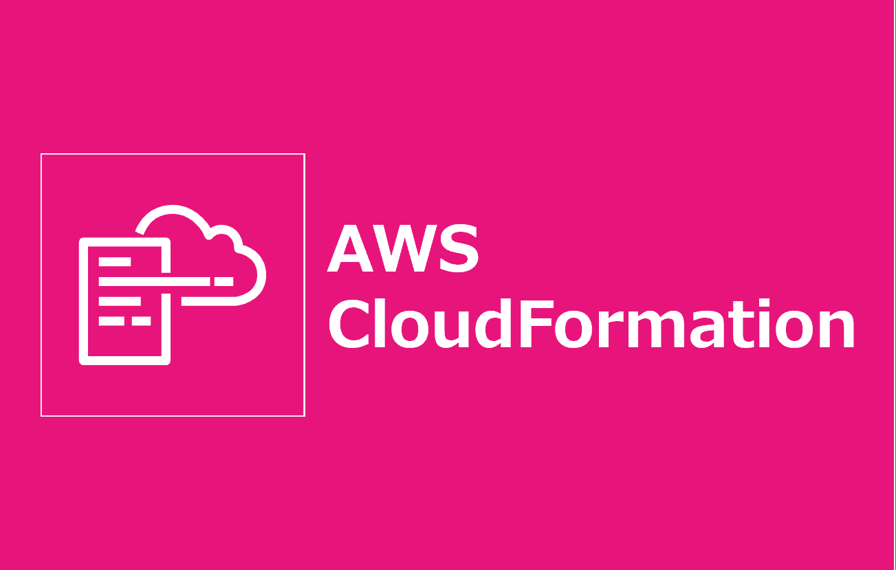

# rain インストール手順

> [!WARNING]
> - *rain* は非推奨 (deprecated) となり、GitHub リポジトリはアーカイブ (読み取り専用) されています
> - 今後、新しいリリース・バグ修正・セキュリティパッチは提供されません (最終リリースは *v1.24.4*)
> - Homebrew の formula も `repo_archived` を理由に deprecated となっています
> - 公式では以下への移行が推奨されています
>   - *CloudFormation* の操作 : [AWS CLI](../awscli)
>   - モジュールなど再利用可能なコンポーネントの作成 : [AWS CDK](../awscdk)
>   - テンプレートの検証 : [CloudFormation Linter](../cfn-lint)
>   - ポリシーチェック : [CloudFormation Guard](../cfn-guard)

> [!NOTE]
> - AWS が開発している *CloudFormation* 用の CLI
> - デプロイ時の変更内容や進捗の表示、テンプレートの整形など、AWS CLI より扱いやすく *CloudFormation* を操作するために使用

## 目次

- [Windows (Git for Windows)](#windows-git-for-windows)
- [Mac](#mac)
- [Linux](#linux)
- [参考資料](#参考資料)

## Windows (Git for Windows)

### 1. *rain* リソースバイナリダウンロード

- [GitHub release page](https://github.com/aws-cloudformation/rain/releases) から64bit版バイナリ( *rain-v1.24.4_windows-amd64.zip* )をダウンロード

```bash
RAIN_V=v1.24.4
curl -o ~/Downloads/#1 -OL https://github.com/aws-cloudformation/rain/releases/download/${RAIN_V}/{rain-${RAIN_V}_windows-amd64.zip}
```

### 2. バイナリデータを任意のフォルダに解凍

```bash
unzip -d ~/ ~/Downloads/rain-${RAIN_V}_windows-amd64.zip
rm -f ~/Downloads/rain-${RAIN_V}_windows-amd64.zip
```

### 3. ディレクトリにPATHを通す

```bash
touch ~/.bashrc # .bashrcがない場合実行
sed -i '$aexport RAIN_V=v1.24.4' ~/.bashrc
sed -i '$aexport PATH=$PATH:$HOME/rain-${RAIN_V}_windows-amd64' ~/.bashrc
source ~/.bashrc
```

> [!NOTE]
> - `rain --version` でバージョンが表示されればOKです

## Mac

### 1. *rain* インストール

```zsh
brew install rain
```

> [!NOTE]
> - `rain --version` でバージョンが表示されればOKです

## Linux

### 1. *rain* リソースバイナリダウンロード

- [GitHub release page](https://github.com/aws-cloudformation/rain/releases) から64bit版バイナリ( *rain-v1.24.4_linux-amd64.zip* )をダウンロード

```bash
RAIN_V=v1.24.4
curl -OL https://github.com/aws-cloudformation/rain/releases/download/${RAIN_V}/rain-${RAIN_V}_linux-amd64.zip
```

### 2. バイナリデータを任意のフォルダに解凍

```bash
unzip rain-${RAIN_V}_linux-amd64.zip
mkdir -p ~/bin; mv rain-${RAIN_V}_linux-amd64/rain ~/bin/; rm -rf rain*
```

### 3. ディレクトリにPATHを通す

```bash
echo 'export PATH="$HOME/bin:$PATH"' >> ~/.bashrc
source ~/.bashrc
```

> [!NOTE]
> - `rain --version` でバージョンが表示されればOKです

## 参考資料

### リファレンス

- [GitHub - aws-cloudformation/rain](https://github.com/aws-cloudformation/rain)

### ブログ

- [WindowsでCloudFormation Rainを動くようにしてみた](https://dev.classmethod.jp/articles/try-cloudformation-rain-on-windows/#toc-7)
