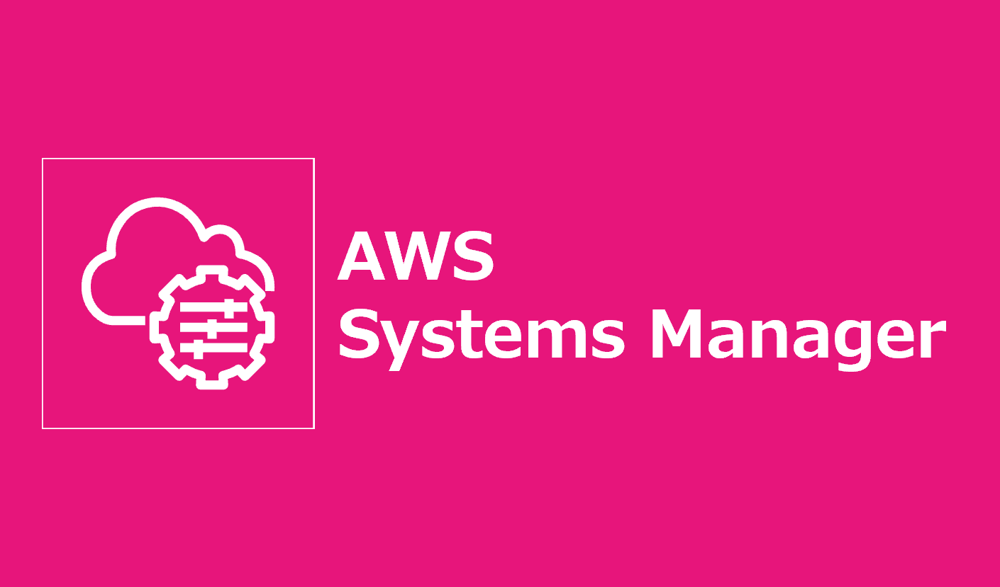

# Session Manager プラグイン インストール手順

> [!NOTE]
> - AWS CLI から *Systems Manager Session Manager* を利用するためのプラグイン
> - SSH キーの管理やインバウンドポートの開放なしに、EC2 への接続やポートフォワーディングを行うために使用

## 目次

- [Windows](#windows)
- [Mac ( with Apple silicon )](#mac--with-apple-silicon-)
- [バージョンアップ](#バージョンアップ)
- [参考資料](#参考資料)

## Windows

### 1. パッケージダウンロード

ブラウザで下記URLを入力

```
https://s3.amazonaws.com/session-manager-downloads/plugin/latest/windows/SessionManagerPluginSetup.exe
```

### 2. インストーラ実行

ダウンロードしたインストーラを実行

### 3. インストール確認

```bash
session-manager-plugin
```

## Mac ( `with Apple silicon` )

### 1. パッケージダウンロード

```zsh
cd ~/Downloads
curl "https://s3.amazonaws.com/session-manager-downloads/plugin/latest/mac_arm64/session-manager-plugin.pkg" -o "session-manager-plugin.pkg"
```

### 2. インストール

```zsh
sudo installer -pkg session-manager-plugin.pkg -target /
sudo mkdir -p /usr/local/bin
sudo ln -s /usr/local/sessionmanagerplugin/bin/session-manager-plugin /usr/local/bin/session-manager-plugin
```

### 3. インストール確認

```zsh
session-manager-plugin
```

## バージョンアップ

| OS | 手順 |
| --- | --- |
| Windows | [Windows の手順 1・2](#1-パッケージダウンロード) を再実行し、最新版のインストーラで上書きインストール |
| Mac ( `with Apple silicon` ) | [Mac の手順 1](#1-パッケージダウンロード-1) と、手順 2 の `sudo installer` を再実行 (シンボリックリンクは作成済みのため `ln -s` は不要) |

> [!NOTE]
> - ダウンロード URL ( `plugin/latest/` ) が常に最新版を指しているため、そのまま再実行すれば最新版になります
> - 更新後、 `session-manager-plugin --version` でバージョンを確認できます

## 参考資料

### リファレンス

- [AWS CLI 用の Session Manager プラグインをインストールする](https://docs.aws.amazon.com/ja_jp/systems-manager/latest/userguide/session-manager-working-with-install-plugin.html)
