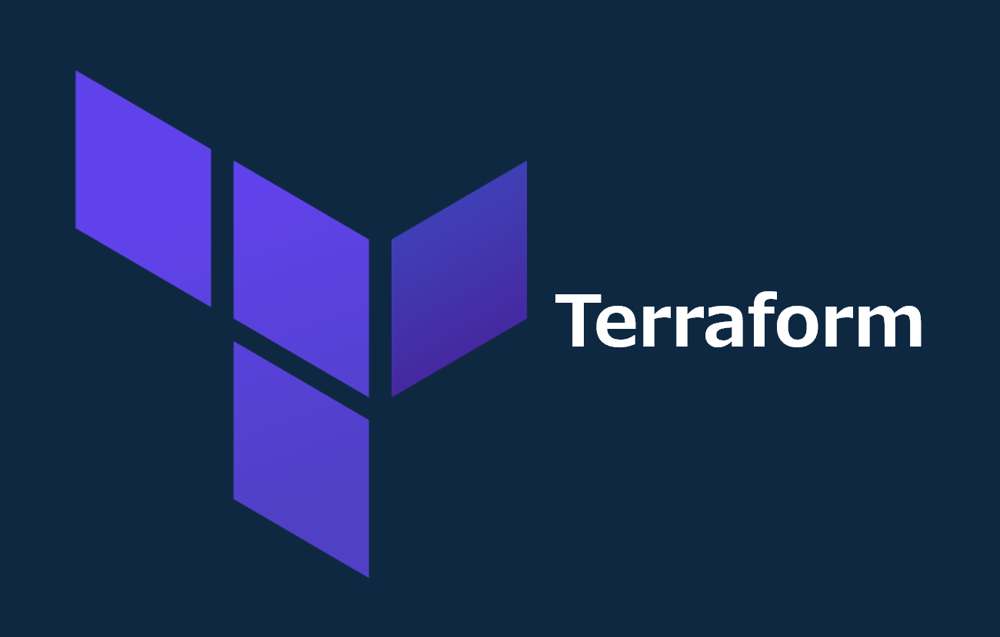

# tenv / Terraform / TFTUI / TFLint インストール手順

> [!NOTE]
> - *Terraform* は HashiCorp が提供する、コードでインフラを定義・構築する IaC ツール
> - *tenv* は *Terraform* / *OpenTofu* 等のバージョン管理ツールで、プロジェクトごとにバージョンを切り替えるために使用
> - *TFTUI* は *Terraform* の state をターミナル上で閲覧・操作する TUI ツール
> - *TFLint* は *Terraform* コードの誤りや非推奨の書き方を検出する Linter

## 目次

- [Windows (Git for Windows)](#windows-git-for-windows)
- [Mac](#mac)
- [Linux](#linux)
- [Terraform 共通設定](#terraform-共通設定)
- [Terraform TUI](#terraform-tui)
- [TFLint](#tflint)
- [参考資料](#参考資料)

## Windows (Git for Windows)

### 1. *tenv* (Terraformバージョンマネージャー)リリースバイナリダウンロード

- [GitHub](https://github.com/tofuutils/tenv/releases) から64bit版バイナリ( *tenv_v4.1.0_Windows_x86_64.zip* )をダウンロード

> [!NOTE]
> バージョンはインストールする値に修正してください

### 2. バイナリデータを任意のフォルダに解凍

```bash
mkdir -p ~/tofuutils/tenv/
unzip -d ~/tofuutils/tenv/ ~/Downloads/tenv_v4.1.0_Windows_x86_64.zip
rm ~/Downloads/tenv_v4.1.0_Windows_x86_64.zip
```

> [!NOTE]
> バージョンはインストールした値に修正してください

### 3. ディレクトリにPATHを通す

```bash
export PATH=$PATH:$HOME/tofuutils/tenv/
touch ~/.bashrc # .bashrcがない場合実行
sed -i '$aexport PATH=$PATH:$HOME/tofuutils/tenv/' ~/.bashrc
```

### 4. *Terraform* 最新版インストール

```bash
tenv tf install latest # ~/.tenv/Terraform/バージョン番号/に保存される
```

### 5. 使用するバージョンの指定

```bash
tenv tf list # インストールしたバージョンを確認
tenv tf use v1.10.3
```

> [!NOTE]
> - バージョンはインストールした値に修正してください
> - *terraform -v* でバージョンが表示されればOKです

## Mac

### 1. *tenv* (Terraformバージョンマネージャー) インストール

```zsh
brew install tenv
```

### 2. *Terraform* 最新版インストール

```zsh
tenv tf install latest # ~/.tenv/Terraform/バージョン番号/に保存される
```

### 3. 使用するバージョンの指定

```bash
tenv tf list # インストールしたバージョンを確認
tenv tf use v1.14.1
```

> [!NOTE]
> - バージョンはインストールした値に修正してください
> - *terraform -v* でバージョンが表示されればOKです

## Linux

### 1. *cosign(v.2.0+)* インストール

> [!NOTE]
> - 最新バージョンの取得に *jq* を使用するため、未インストールの場合は事前に `sudo dnf install -y jq` を実行してください

```bash
cd
LATEST_VERSION=$(curl https://api.github.com/repos/sigstore/cosign/releases/latest | jq -r .tag_name | tr -d "v")
curl -O -L "https://github.com/sigstore/cosign/releases/latest/download/cosign-${LATEST_VERSION}-1.x86_64.rpm"
sudo rpm -ivh cosign-${LATEST_VERSION}-1.x86_64.rpm && rm -rf cosign-${LATEST_VERSION}-1.x86_64.rpm
```

### 2. リポジトリ登録

```bash
curl -1sLf 'https://dl.cloudsmith.io/public/tofuutils/tenv/cfg/setup/bash.rpm.sh' | sudo bash
```

### 3. *tenv* インストール

```bash
sudo dnf install tenv -y
```

### 4. *Terraform* 最新版インストール

```bash
tenv tf install latest # ~/.tenv/Terraform/バージョン番号/に保存される
```

### 5. 使用するバージョンの指定

```bash
tenv tf list # インストールしたバージョンを確認
tenv tf use v1.10.3
```

> [!NOTE]
> - バージョンはインストールした値に修正してください
> - *terraform -v* でバージョンが表示されればOKです

## Terraform 共通設定

### gitignore

- [gitignore.io](https://www.toptal.com/developers/gitignore) にて *terraform* と入力し *.gitignore* を作成
- terraformコードを格納するフォルダに保存

## Terraform TUI

### Windows

#### 1. *tftui* インストール

- [GitHub](https://github.com/idoavrah/terraform-tui/tree/main) のパッケージを *uv* でインストール

```bash
uv tool install tftui
```

> [!NOTE]
> - *uv* のセットアップは [こちら](../uv_python3/README.md) を参照
> - `uv tool list` に *tftui* が表示されればOKです

> [!TIP]
> - *pyenv* ( [こちら](../pyenv_python3/README.md) ) や *PIM* ( [こちら](../pim/README.md) ) で *Python* をインストールしている場合は、 *pip* でもインストール可能です
>
> ```bash
> pip install tftui
> ```

### Mac

#### 1. *tftui* インストール

```zsh
brew install idoavrah/homebrew/tftui
```

### Linux

#### 1. *tftui* インストール

- [GitHub](https://github.com/idoavrah/terraform-tui/tree/main) のパッケージを *uv* でインストール

```bash
uv tool install tftui
```

> [!NOTE]
> - *uv* のセットアップは [こちら](../uv_python3/README.md) を参照
> - `uv tool list` に *tftui* が表示されればOKです

> [!TIP]
> - *pyenv* ( [こちら](../pyenv_python3/README.md) ) で *Python* をインストールしている場合は、 *pip* でもインストール可能です
>
> ```bash
> pip install tftui
> ```

## TFLint

### Windows

#### 1. *tflint* インストール

```bash
winget install -e --id TerraformLinters.tflint
```

> [!NOTE]
> - インストール後、 *Git Bash* を再起動してください
> - `tflint --version` でバージョンが表示されればOKです

### Mac

#### 1. *tflint* インストール

```zsh
brew install --cask terraform-linters/tap/tflint
```

> [!NOTE]
> - `tflint --version` でバージョンが表示されればOKです

### Linux

#### 1. *tflint* リリースバイナリダウンロード

```bash
cd
curl -sSLO https://github.com/terraform-linters/tflint/releases/latest/download/tflint_linux_amd64.zip
curl -sSLO https://github.com/terraform-linters/tflint/releases/latest/download/checksums.txt
```

> [!NOTE]
> - ARM 環境の場合は *tflint_linux_arm64.zip* に読み替えてください

#### 2. チェックサム検証

```bash
sha256sum --ignore-missing -c checksums.txt # tflint_linux_amd64.zip: OK と表示されればOK
```

> [!TIP]
> - *GitHub CLI* ( [こちら](../github_cli/README.md) ) をインストールしている場合は、 `checksums.txt` 自体の正当性も検証可能です
>
> ```bash
> gh attestation verify checksums.txt -R terraform-linters/tflint
> ```

#### 3. *tflint* インストール

```bash
unzip tflint_linux_amd64.zip
sudo install -c -v tflint /usr/local/bin/
rm -f tflint tflint_linux_amd64.zip checksums.txt
```

> [!NOTE]
> - *unzip* が未インストールの場合は事前に `sudo dnf install -y unzip` を実行してください
> - `tflint --version` でバージョンが表示されればOKです

### TFLint 共通設定

#### 1. 設定ファイル作成

- terraformコードを格納するフォルダに *.tflint.hcl* を作成 (以下は AWS 用ルールセットを有効化する例)

```hcl
plugin "terraform" {
  enabled = true
  preset  = "recommended"
}

plugin "aws" {
  enabled = true
  version = "0.50.0"
  source  = "github.com/terraform-linters/tflint-ruleset-aws"
}
```

> [!NOTE]
> - *version* は [tflint-ruleset-aws](https://github.com/terraform-linters/tflint-ruleset-aws/releases) の最新版に修正してください

#### 2. プラグインインストール・実行

```bash
tflint --init # .tflint.hcl に定義したプラグインをインストール
tflint --recursive # サブディレクトリも含めて検査
```

## 参考資料

### リファレンス

- [tofuutils/tenv - GitHub](https://github.com/tofuutils/tenv)
- [idoavrah/terraform-tui - GitHub](https://github.com/idoavrah/terraform-tui/tree/main)
- [terraform-linters/tflint - GitHub](https://github.com/terraform-linters/tflint)
- [terraform-linters/tflint-ruleset-aws - GitHub](https://github.com/terraform-linters/tflint-ruleset-aws)
- [gitignore.io](https://www.toptal.com/developers/gitignore)

### ブログ

- [新しいTerraformのバージョンマネージャー tenv を試してみた](https://dev.classmethod.jp/articles/try-tenv-terraform-version-manager/)
- [kazmax - Linuxで自宅サーバー](https://kazmax.zpp.jp/linux_beginner/yum_repository_enable_disable.html)
